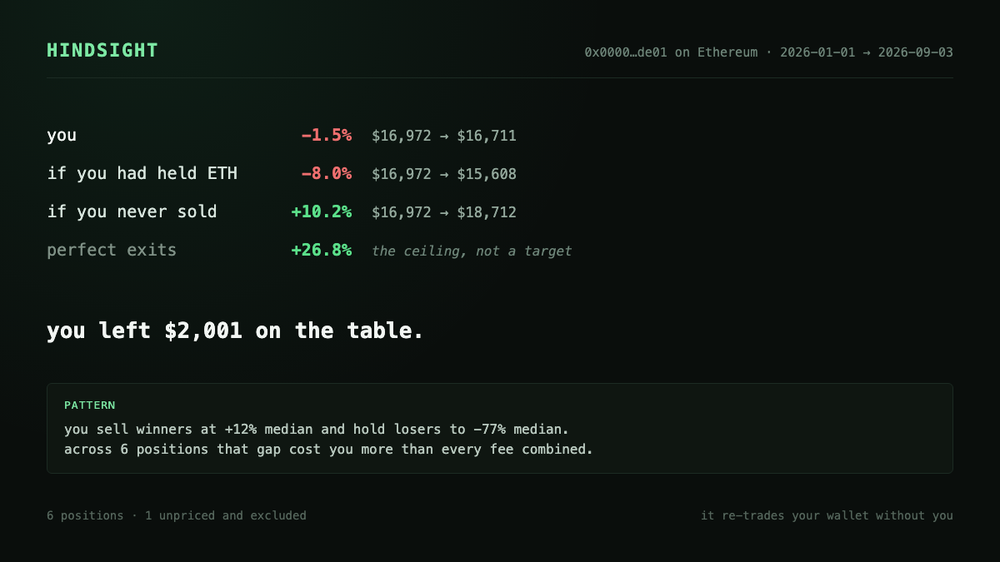

# hindsight

*It re-trades your wallet without you, and shows you the money you left on the table.*

[](https://github.com/defi0x1/hindsight/actions/workflows/test.yml)
[](LICENSE)


hindsight takes a public EVM wallet address, reconstructs every swap it
made from on-chain logs, and compares what actually happened against three
deterministic alternatives. It makes read-only RPC calls against public
addresses: it never asks for a private key or a seed phrase, never signs
anything, and never sends a transaction. Every number in the output comes
from arithmetic over on-chain data; the only thing a language model is
ever allowed to write is one paragraph naming a behavioral pattern the
arithmetic already found, and that step is optional. It runs against a
bundled offline fixture with no RPC and no API key at all.

## What it looks like

This is real, unedited output from `hindsight demo` -- the bundled
fixture, run offline, no network access:

```
HINDSIGHT · 0x0000…de01 · 2026-01-01 → 2026-09-03

  you                        -1.5%    $16,972 → $16,711
  if you had held ETH        -8.0%    $16,972 → $15,608
  if you never sold         +10.2%
  perfect exits             +26.8%    (the ceiling, not a target)

  you left $2,001 on the table.

  LEAKS
    priority fees              $62   across 18 txs
    failed transactions        $41   across 4 failures

  PATTERN
    you sell winners at +12% median and hold losers to -77% median.
    across 6 positions that gap cost you more than every fee combined.

  6 positions · 1 unpriced and excluded
```

`--card out.html` writes the same report as one self-contained HTML file,
sized for a screenshot. No CDN, no external fonts, no network:



## Install

hindsight is not published to npm. Clone and build it:

```
git clone https://github.com/defi0x1/hindsight
cd hindsight
npm install
npm run build
npm link
```

## Quickstart

```
hindsight demo
hindsight leaks 0xYourAddressHere
hindsight positions 0xYourAddressHere --chain base
```

`hindsight demo` works completely offline against a bundled fixture --
run it first to see the full report shape before pointing hindsight at a
real wallet.

## How the numbers are made

- **Trades are reconstructed from ERC-20 `Transfer` logs, not decoded
  calldata.** hindsight scans `eth_getLogs` for the wallet's outgoing and
  incoming transfers, groups them by transaction hash, and reads what
  moved. This is router-agnostic: it works for Uniswap, 1inch, CoWSwap, or
  an aggregator that doesn't exist yet, without a single line of
  per-program code.
- **Every swap prices itself.** A transaction that moves `-2.5 WETH` and
  `+1,000,000 TOKEN` tells you exactly what TOKEN cost at that block's
  timestamp. hindsight needs only one external series -- native/USD -- to
  turn that into a dollar figure. There is no paid historical price API
  anywhere in this codebase.
- **Cost basis is FIFO**, per token, computed from the swaps themselves.
- **A trade with no path to a quote asset (WETH/USDC/USDT/DAI) is marked
  `unpriced` and excluded from every total** -- never guessed. The final
  line of every report says how many were excluded.
- **No model touches any of these numbers.** The only prose hindsight ever
  produces is the `PATTERN` paragraph, generated from a fixed set of
  deterministic templates chosen by the computed behavioral metrics. An
  optional `agent` config block can hand the same metrics to a CLI for a
  better-written paragraph -- strictly an upgrade, never required, and the
  full report works with no agent configured at all.

Full detail, including exactly where a number can be wrong, is in
[`docs/how-pnl-is-computed.md`](docs/how-pnl-is-computed.md).

## The four benchmarks

| | |
|---|---|
| **actual** | realized + unrealized PnL, in USD |
| **if you had held `<NATIVE>`** | the same capital, converted to the chain's native asset at each deposit and held to the end date |
| **if you never sold** | every buy held to now, every sell reversed |
| **perfect exits** | every position sold at the highest price this wallet's own trade history observed for it |

**"perfect exits" is a ceiling, not a target.** It is bounded by prices
the wallet's own transactions happened to see, not a true all-time high,
and it is not achievable. The report labels it explicitly everywhere it
appears. Full construction of each row, and why, is in
[`docs/benchmarks.md`](docs/benchmarks.md).

## Configuration

**Chains** are config, not code -- `data/chains.json` has one entry per
chain (`chainId`, `rpcUrl`, `nativeSymbol`, native/USD series file,
explorer URL, and a `quoteAssets` list). Select one with `--chain
<name|id>`; it defaults to Ethereum mainnet.

| chain | id | native | quote assets |
|---|---|---|---|
| Ethereum | 1 | ETH | WETH, USDC, USDT, DAI |
| Base | 8453 | ETH | WETH, USDC, DAI |
| Arbitrum One | 42161 | ETH | WETH, USDC, USDT, DAI |
| Optimism | 10 | ETH | WETH, USDC, USDT, DAI |
| Polygon | 137 | POL | WPOL, USDC, USDT, DAI -- no bundled native/USD series, so gas is reported in POL, not USD |
| Robinhood Chain | 4663 | ETH | none configured yet -- **leaks and approvals only**; PnL and benchmarks need quote assets added first (see below) |

Adding a chain, or adding a quote asset to an existing chain, is a JSON
edit to `data/chains.json`, never a code change --
[`docs/how-pnl-is-computed.md`](docs/how-pnl-is-computed.md#chain-config-and-adding-quote-assets)
covers exactly what's required (a verified token address and its correct
`decimals`). Running any pricing-dependent command against a chain with no
quote assets configured prints an explicit warning instead of silently
returning an empty-looking report.

**RPC endpoint**: `--rpc <url>` or `HINDSIGHT_RPC_URL`, defaulting to each
chain's public endpoint with a printed warning that it is slow and
rate-limited on `eth_getLogs` -- a dedicated provider (Alchemy, Infura,
QuickNode, or the chain's own paid tier) is materially better.

**Cache**: every RPC response is cached to `.hindsight/cache/<chainId>/`.
A rerun against a wallet you've already scanned costs zero network calls
for the block ranges already covered.

**Optional agent block**, in `.hindsight.json`:

```json
{
  "agent": {
    "command": "claude",
    "args": ["-p", "--output-format", "text"],
    "timeoutMs": 10000
  }
}
```

If present, the computed behavioral metrics are handed to this command on
stdin and its stdout becomes the `PATTERN` paragraph. If it's absent, times
out, or fails, hindsight falls back to the deterministic template -- the
report is never blocked on it.

## Works with loop-rat

hindsight runs as a weekly, report-only loop in `.claude/loops/hindsight/`
for [loop-rat](https://github.com/mrbuzzoni/loop-rat): the deterministic
report is the verify step, and the model's only job in the whole loop is
writing the `PATTERN` paragraph from metrics hindsight already computed.
There is no trading action anywhere in the loop -- it produces a report,
not an order. hindsight is fully standalone and needs neither loop-rat nor
any model to run.

## Limitations

- **v1 covers spot swaps only.** Perpetuals, LP positions, staking,
  lending, and cross-chain bridge flows are not modeled and will skew
  results for a wallet that uses them -- a bridged-out balance looks like
  money that vanished, a staked position looks like an open buy that never
  resolves.
- **Tokens with no path to a quote asset are excluded and counted**, not
  guessed at. See `docs/how-pnl-is-computed.md` for exactly which cases
  this covers.
- **Airdrops and transfers-in are treated as deposits at receipt-time
  value** -- a quote asset is valued from the native/USD series; a
  non-quote token has no independent price source and is recorded at zero
  cost basis, which overstates its later realized gain.
- **Reverted transactions require a bounded full-block sweep to detect**,
  since a reverted call emits no logs at all. That sweep is capped by
  block count; a wide range without `--since` will under-count fees and
  failures and say so explicitly rather than guess.
- **Public RPC endpoints are slow and rate-limited**, particularly for
  `eth_getLogs`. Use `--rpc` with a dedicated provider for anything beyond
  a quick check.
- **The native/USD price series is daily.** Intraday moves are
  approximated by linear interpolation between the nearest two known days.
- **This is analysis of public blockchain data, not financial advice.**
  Nothing in this tool's output is a recommendation to buy, sell, or hold
  anything, and "perfect exits" is a labeled fantasy ceiling, not a
  target.

## Development

```
git clone https://github.com/defi0x1/hindsight
cd hindsight
npm install
npm run build
node --test dist/tests/*.test.js
```

`hindsight demo` runs the full pipeline against `fixtures/demo/` --
cached, synthetic RPC responses for a wallet with winners, losers, round
trips, failed transactions, and a deliberately unpriced token-to-token
swap. Use it to sanity-check any change with zero network calls.

`tests/smoke.sh` builds, runs the unit tests, and runs the offline demo
end to end; it's what CI runs.

Refreshing `data/eth-usd.json`: replace it with a `{"YYYY-MM-DD": price}`
object of daily close prices, one entry per day, no gaps required --
missing days interpolate linearly between the nearest two available.

See [`CONTRIBUTING.md`](CONTRIBUTING.md) for scope boundaries (zero
runtime dependencies, no per-DEX decoders, no number that isn't traced to
on-chain arithmetic) before proposing a change.

## License

MIT, see [`LICENSE`](LICENSE).
